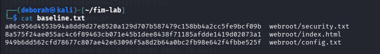
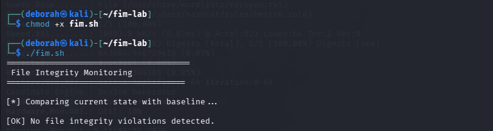
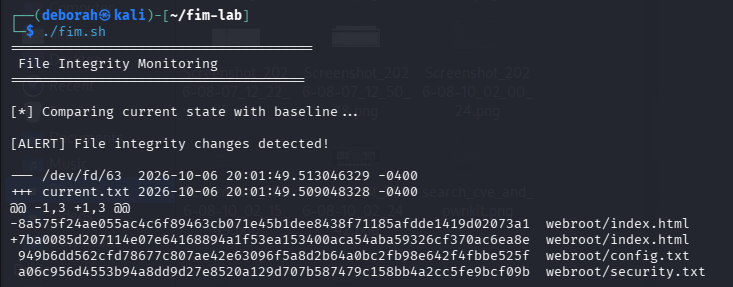
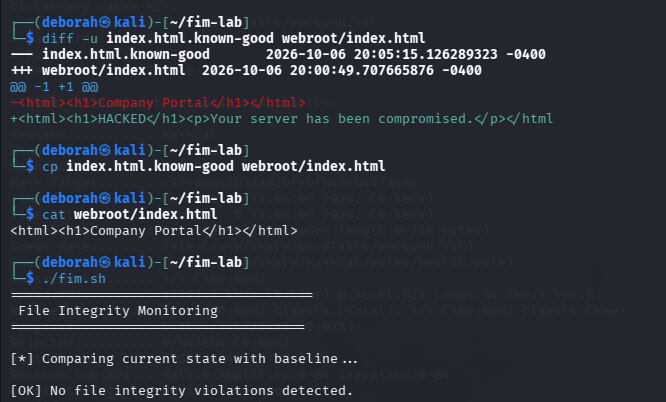

# Linux File Integrity Monitoring — Incident Report

## 1. Incident Overview

| Field                | Details                                         |
| -------------------- | ----------------------------------------------- |
| **Incident ID**      | FIM-001                                         |
| **Incident Type**    | Unauthorized File Modification / Web Defacement |
| **Severity**         | Medium                                          |
| **Affected System**  | Kali Linux — simulated web server               |
| **Affected File**    | `~/fim-lab/webroot/index.html`                  |
| **Detection Method** | SHA-256 File Integrity Monitoring               |
| **Status**           | Resolved                                        |
| **Environment**      | Isolated security lab                           |

### Executive Summary

A simulated web defacement incident was detected on a Linux system using File Integrity Monitoring (FIM).

A trusted baseline was first established by calculating SHA-256 hashes for monitored files. A simulated attacker then modified the web server's `index.html` file. When FIM was executed again, the newly calculated hash did not match the trusted baseline, generating an integrity alert.

The affected file was investigated by reviewing its metadata and comparing its contents against a known-good copy. The file was then restored and FIM was executed again to verify that the system had returned to its trusted state.

This exercise demonstrated the basic SOC workflow of **baseline → detection → investigation → remediation → verification**.

---

## 2. What is FIM?

**File Integrity Monitoring (FIM)** is a security technique used to detect unauthorized changes to files and directories.

FIM can establish a baseline of trusted files using cryptographic hashes such as SHA-256. When a monitored file changes, its cryptographic hash will normally change as well. Comparing the current hash against the trusted baseline can therefore reveal unexpected modifications.

SOC teams can use FIM to detect events such as:

* Web defacement
* Tampering with configuration files
* Modification of system files
* Unauthorized software changes
* Malware or backdoor deployment
* Changes made after an attacker gains access to a system

For this lab, I created a small simulated web server on Kali Linux and performed both the attacker and SOC analyst roles in an isolated environment.

---

# 3. Lab Environment

### Operating System

* Kali Linux

### Tools

* Bash
* `sha256sum`
* `find`
* `diff`
* `stat`
* Linux file system utilities

### Lab Directory

```text
~/fim-lab/
├── baseline.txt
├── fim.sh
├── webroot/
│   ├── index.html
│   ├── config.txt
│   └── security.txt
└── evidence/
```

---

# 4. Initial State

I created a simulated webroot containing three files representing files that could be considered important to a web server:

```text
webroot/index.html
webroot/config.txt
webroot/security.txt
```

The homepage initially contained trusted content:

```html
<html><h1>Company Portal</h1></html>
```

The system was considered to be in a known-good state before monitoring began.

### Evidence

**Figure 1 — Initial monitored files in the simulated webroot.**



---

# 5. Establishing the Trusted Baseline

The first step was to establish a trusted baseline.

I calculated SHA-256 hashes for the monitored files and stored the results in `baseline.txt`.

```bash
find webroot -type f -exec sha256sum {} \; > baseline.txt
```

The resulting hashes represented the known-good state of the monitored files.

For example:

```text
<hash>  webroot/index.html
<hash>  webroot/config.txt
<hash>  webroot/security.txt
```

The baseline provides a reference point against which future file states can be compared.

### Evidence

**Figure 2 — SHA-256 baseline containing the trusted hashes of the monitored files.**


---

# 6. FIM Detection Script

I created a Bash script called `fim.sh` to automate the integrity check.

The script:

1. Calculates the current SHA-256 hashes.
2. Stores them in `current.txt`.
3. Compares them against the trusted baseline.
4. Reports whether a change was detected.
5. Saves the differences to `changes.txt`.

The initial FIM check returned:

```text
[OK] No file integrity violations detected.
```

This confirmed that the current files matched the established baseline.

### Evidence

**Figure 3 — Initial FIM check confirming that no integrity violations were detected.**



---

# 7. Simulated Security Incident

To simulate a web defacement attack, I modified `index.html`.

The original content:

```html
<html><h1>Company Portal</h1></html>
```

was replaced with:

```html
<html>
<h1>HACKED</h1>
<p>Your server has been compromised.</p>
</html>
```

This represented an attacker gaining the ability to modify content on a web server.

### Evidence

**Figure 4 — Modified `index.html` showing the simulated web defacement.**


---

# 8. Detection

I ran the FIM script again:

```bash
./fim.sh
```

This time, the script detected an integrity violation:

```text
[ALERT] File integrity changes detected!
```

The comparison showed that the SHA-256 hash of `index.html` had changed.

This occurred because even a small modification to a file produces a different cryptographic hash.

### Detection Flow

```text
Trusted File
     ↓
SHA-256 Hash
     ↓
Baseline
     ↓
File Modified
     ↓
New SHA-256 Hash
     ↓
Hash Mismatch
     ↓
FIM ALERT
```

### Evidence

**Figure 5 — FIM alert identifying a change to the monitored file.**



---

# 9. Investigation

After detecting the integrity violation, I investigated the affected file rather than immediately restoring it.

## 9.1 File Metadata

I used:

```bash
stat webroot/index.html
```

This provided information including:

* File modification time
* Access time
* File size
* File permissions

The modification timestamp can be useful when building an incident timeline and correlating the event with other security logs.

## 9.2 Directory Review

I also reviewed the monitored directory:

```bash
ls -la webroot/
```

This allowed me to check the files, permissions and timestamps within the webroot.

## 9.3 Content Comparison

I recreated the known-good version of the homepage:

```bash
echo "<html><h1>Company Portal</h1></html>" > index.html.known-good
```

I then compared it against the modified file:

```bash
diff -u index.html.known-good webroot/index.html
```

The comparison confirmed that the homepage content had been changed from the legitimate **Company Portal** page to the simulated **HACKED** page.

### Investigation Finding

The FIM alert was confirmed to be a legitimate integrity violation rather than a false positive.

**Affected file:**

```text
webroot/index.html
```

**Observed change:**

```text
Company Portal
        ↓
HACKED
```

**Assessment:**

The modification was consistent with a simulated web defacement event.

### Evidence

**Figure 6 — Investigation showing the difference between the known-good and modified versions of `index.html`.**


---

# 10. Remediation

The affected file was restored using the known-good copy:

```bash
cp index.html.known-good webroot/index.html
```

I then verified the contents:

```bash
cat webroot/index.html
```

The original trusted content was restored:

```html
<html><h1>Company Portal</h1></html>
```

### Evidence

**Figure 7 — Restored `index.html` after remediation.**



---

# 11. Verification

After remediation, I ran the FIM check again:

```bash
./fim.sh
```

The result was:

```text
[OK] No file integrity violations detected.
```

This confirmed that the monitored file once again matched the trusted baseline.

### Evidence

**Figure 8 — Final FIM verification confirming that the integrity violation has been resolved.**


---

# 12. Incident Timeline

| Stage  | Event                                         |
| ------ | --------------------------------------------- |
| **T0** | Monitored files created in a known-good state |
| **T1** | SHA-256 baseline established                  |
| **T2** | Initial FIM check returned no violations      |
| **T3** | Simulated attacker modified `index.html`      |
| **T4** | FIM detected a SHA-256 hash mismatch          |
| **T5** | File metadata and contents investigated       |
| **T6** | Unauthorized modification confirmed           |
| **T7** | Known-good file restored                      |
| **T8** | FIM verification returned no violations       |
| **T9** | Incident considered resolved                  |

---

# 13. Root Cause

The simulated incident was caused by an unauthorized modification to a monitored web server file.

In a real environment, the modification could potentially result from:

* Compromised user credentials
* Exploitation of a vulnerable web application
* Malware
* Unauthorized administrator activity
* An attacker gaining shell access
* Exploitation of a vulnerable service

Because this was a controlled lab, no real attacker or external system was involved.

---

# 14. Impact Assessment

The simulated incident affected the contents of one web page.

### Observed impact

* One monitored file was modified.
* The legitimate homepage content was replaced.
* The modification was detected through FIM.
* The file was restored successfully.
* No other files were identified as modified during the exercise.

In a production environment, web defacement could affect an organization's reputation, customer trust and availability of legitimate web content.

---

# 15. Detection and Response

This lab demonstrated the following SOC capabilities:

| Capability                       | Demonstrated |
| -------------------------------- | ------------ |
| Establishing a security baseline | ✅            |
| Hash-based integrity monitoring  | ✅            |
| Security alert detection         | ✅            |
| File investigation               | ✅            |
| Metadata analysis                | ✅            |
| Content comparison               | ✅            |
| Incident classification          | ✅            |
| Remediation                      | ✅            |
| Post-remediation verification    | ✅            |
| Basic security logging           | ✅            |

---

# 16. Logging Enhancement

To make the FIM solution more SOC-oriented, I modified the Bash script to record detected events with timestamps in `fim.log`.

The logging functionality records:

```text
[TIMESTAMP] ALERT: File integrity changes detected!
```

and appends the detected changes to the log.

This provides a basic event history that could later be forwarded to a centralized monitoring solution.

---

# 17. Lessons Learned

This lab helped me understand that FIM is more than simply calculating file hashes.

The important security workflow is:

```text
Baseline
   ↓
Monitor
   ↓
Detect
   ↓
Investigate
   ↓
Remediate
   ↓
Verify
   ↓
Document
```

I also learned that an integrity alert does not automatically mean that an attack has occurred. A SOC analyst needs to investigate the change, determine whether it was authorized, understand what changed and assess its potential impact.

---

# 18. Future Improvements

The current implementation is a basic Bash-based FIM solution. A production environment would require more robust monitoring and centralized visibility.

Potential improvements include:

* Real-time monitoring using Wazuh
* Monitoring multiple endpoints
* Centralized alert collection
* User attribution
* Integration with SIEM platforms
* Automated alerting
* File change timelines
* MITRE ATT&CK mapping
* Automated incident response
* Alert correlation with authentication and process events

The next stage of this lab would be to implement FIM using **Wazuh** and generate a centralized SOC alert when a monitored file is modified.

---

# 19. Conclusion

This lab demonstrated how File Integrity Monitoring can be used to detect unauthorized modifications to critical files.

By establishing a trusted SHA-256 baseline, simulating a web defacement, detecting the resulting hash mismatch, investigating the modification, restoring the affected file and verifying the final state, I was able to reproduce a simplified SOC incident-response workflow.

The exercise reinforced the importance of FIM as a detection mechanism for identifying unexpected changes that may indicate compromise, tampering or other security events.